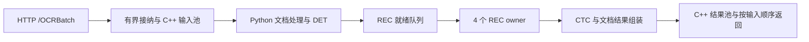

# OCR on Jetson

面向 **NVIDIA Jetson Xavier NX** 的文档 OCR 端侧部署源码，包含原 Python 文档处理业务、TensorRT 8.2 模型适配、CUDA 插件，以及 C++ / Python 协作的批量 OCR 服务。

最新完成的批服务方案为 **E167：4 个 REC owner 线程**。E168 补充了真实 HTTP 场景的 GPU kernel 并发证据。源码于 **2026-11-16** 从开发目录及板端交付文件整理；性能与验收数字来自 2026-10-31 及之前的实验，源码发布当天未重新运行 GPU 验收。

## 功能与架构

- 每批接收 1～4 张图片，支持普通 OCR 与按类型增强，输出文本、原图坐标和 Markdown。
- C++ 输入与结果线程池负责有界调度、资源信用、deadline、取消和结果交接；Python 保留文档业务、模型适配及预后处理。
- 通过常驻私有 Unix socket 连接协作，使用 input / gpu / result 控制通道与独立 events 通道。
- REC 使用 4 个 owner 线程，每个 owner 管理自己的 TensorRT 会话、execution context、stream 和输入输出缓冲；每项 REC 仍为 batch=1。
- 支持范围内的 JPEG 接入 Jetson 硬件解码；兼容类型和实际 shape 的 DET 请求可组成 batch=2，尾项保留 batch=1。
- 包含旧版 TensorRT 的 ONNX 兼容改写、GridSample CUDA 插件、宽 REC 适配，以及量化、混合精度、消融和时间线分析代码。



## 目录

| 路径 | 内容 |
| --- | --- |
| `server.py`、`server_config.py`、`layout/` | 从板端 jetson-r2 取回的原业务源码 |
| `ner_postprocess.py`、`train_mobilenetv3_321.py`、`words.py` | NER 后处理、增强网络定义和业务辅助代码 |
| `edge_deploy/jetson/batch_ocr/` | E167 C++ 应用、IPC、调度、批 HTTP、REC owner 与 JPEG 局部补丁；源码与本次板端副本核对一致（允许换行差异） |
| `edge_deploy/jetson/` | TensorRT 8.2 适配、CUDA 插件、模型构建和验证工具 |
| `edge_deploy/jetson/threaded_service/` | E167 并发选择、验收与启动器 |
| `edge_deploy/jetson/http_rec_trace/` | E168 真实 HTTP 时间线采样与分析 |
| `edge_deploy/jetson/ablation/`、`rec_concurrency/` | 消融与合成 REC 并发实验 |
| `edge_deploy/business/`、`tools/`、`tests/` | 业务部署辅助、模型工具和回归检查；部分属于早期 Windows / WSL 阶段 |
| `deployment/` | 板端基础适配器、宽 REC 配置及 E167 启动配置快照，见[说明](deployment/README.md) |

## 环境与外部依赖

已验证的板端组合为 Xavier NX / aarch64、Ubuntu 18.04 / L4T 32.7.1、CUDA 10.2、TensorRT 8.2.1，以及项目独立的 Python 3.10 环境。应用使用项目本地 TensorRT Python 绑定；系统 Python 3.6 不适合运行当前源码。

[requirements-host.txt](edge_deploy/jetson/requirements-host.txt)记录应用直接依赖版本，其中 PyTorch 是 CPU 构建，GPU 推理由 TensorRT 适配器负责。该清单不是完整离线环境锁文件；旧版 glibc、ARM64 wheel、TensorRT 绑定和 NVIDIA 库需要与目标板匹配。

**本仓库是源码交付，不包含模型权重、ONNX / TensorRT 引擎、词典与 tokenizer 数据、SDK / 系统库、Python 环境、测试图片或实验原始大文件。** 运行完整服务还需要准备这些资源，并按原部署配置核对路径和 SHA。已有启动器及完整性校验保留原板端目录约定，不能直接在任意机器 clone 后启动。

## 构建 C++ 组件

在 Linux 上使用支持 C++14 的编译器及 CMake 3.10 或以上版本：

```bash
cmake -S edge_deploy/jetson/batch_ocr -B build/batch_ocr \
  -DCMAKE_BUILD_TYPE=Release -DAUTOOCR_BUILD_JPEG=OFF
cmake --build build/batch_ocr -j2
cd build/batch_ocr
ctest --output-on-failure
```

上述构建关闭硬件 JPEG，仅构建 C++ 调度、IPC 和应用组件，不能代替完整模型环境验收。CMake 3.10 不支持 `-S/-B` 时，可先进入空构建目录，再执行 `cmake /path/to/OCR-on-jetson/edge_deploy/jetson/batch_ocr ...`。

可在不加载模型的情况下运行以下 Python 检查：

```bash
python3 -m unittest discover -s edge_deploy/tests -p test_public_source.py
python3 -m unittest discover -s edge_deploy/jetson/batch_ocr/multistream -p test_threaded_rec.py
```

启用硬件 JPEG 需要目标 L4T 对应的 Multimedia API 源码、NVJPEG 和 V4L2 库，配置 `AUTOOCR_BUILD_JPEG=ON` 与 `JETSON_MMAPI`。构建会核对 SDK 源文件 SHA，并只对构建目录内副本应用 [partial-MCU 补丁](edge_deploy/jetson/batch_ocr/patches/nvjpeg-partial-mcu.patch)。

## 批 HTTP 接口

正式批入口为 `POST /OCRBatch`，默认只监听 `127.0.0.1:5052`；`GET /healthz` 读取状态，不执行推理。这个批服务没有接入 `/Extract`，也不提供旧 `/OCR` 路由。

```json
{
  "images": [
    {"imageId": "doc1", "imageType": 3, "imageBase64": "RAW_BASE64"}
  ]
}
```

- 每批 1～4 图，`imageId` 唯一；类型 3 为普通路径，1 / 2 经过增强。
- 请求使用 `application/json` 与 `Content-Length`，上限 24 MiB；Base64 不带 data URL 前缀。
- 返回项的 ID 字段为 `image_id`。输入错误、忙碌与超限等状态见[接口契约](edge_deploy/jetson/batch_ocr/app/BATCH_API.md)。
- `AUTOOCR_REC_THREADS=1` 是启用 owner 实现的开关，`AUTOOCR_REC_SLOTS=4` 才是 owner 数。
- 启动器默认启用硬件 JPEG 与 DET N2；显式设置对应开关为 0 可关闭。

在资源、原目录和服务状态均已核对的原板端部署中，启动入口为：

```bash
bash /home/xchq/work/autoocr/overlays/batch-ocr-threaded-e167-r1/start_threaded.sh
```

该入口显式使用原项目已确认的开发免许可模式，仅绑定回环地址。已有实例运行时不要重复加载另一套模型。远程访问可使用自己的 SSH 配置做本地转发。

## 已验证结果及范围

| 实验 | 结果 | 统计范围 |
| --- | --- | --- |
| E167 实际 HTTP | 96 页耗时由首尾同步基线均值 316.510746 秒降至 275.091184 秒；吞吐提升 **15.0567%** | 16 张独立图 × 两种类型，预热后重复测量；存在首尾漂移，不能单独归因于线程数 |
| E168 HTTP GPU 时间线 | 观察到 4 个不同 REC owner 的 kernel 共同执行；至少四路累计约 100.476 ms，占映射 REC kernel 活跃并集 **0.3733%** | 临时采样窗口，不能当成持续四路或普通未采样服务的长期占比 |

详细方法见 [E167](edge_deploy/jetson/threaded_service/README.md) 与 [E168](edge_deploy/jetson/http_rec_trace/README.md)。E168 的初始化失败和停止观察超时记录保留，后续独立核校完整采样与安全退出，不改写原失败状态。硬解和 DET N2 有功能验证，但没有独立端到端提速结论。

公开结果 SHA 一致属于回归一致性证据；GT / CER、全 673 图推理、24 小时运行、实车和跨设备安装复现尚未完成。

## 源码发布说明

公开副本已移除旧许可种子、密钥及计数加密参数。相关旧许可函数会在缺少私有配置时明确报错；未发布许可文件、计数文件或硬件身份。该脱敏不修改板端原文件，不构成新的授权/激活方式。

`.gitignore` 覆盖模型、环境、数据、构建产物、日志、归档与本机凭据。第三方 `nlohmann/json` 保留其 [MIT 许可证](edge_deploy/jetson/batch_ocr/third_party/nlohmann_json/LICENSE.MIT)；其他依赖仍遵循各自许可，本次上传未替项目整体新增许可证。
